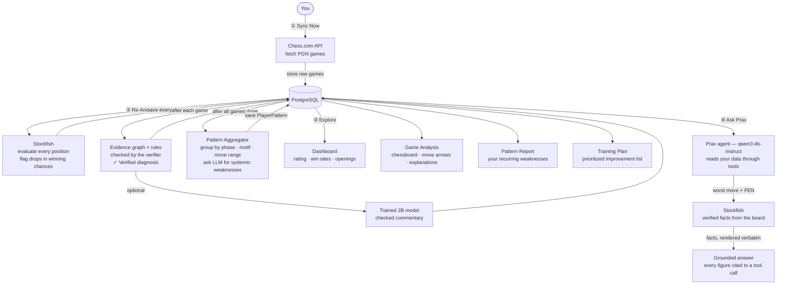

# Praxis-Chess


A personal, local-first chess analytics and improvement system. Connect your Chess.com account, let the AI analyze your games, identify your recurring weaknesses, and generate a training plan tailored to your actual play — not generic advice.

Built with **Java 21+ and Spring Boot 3.5**, **PostgreSQL**, **Stockfish**, **Ollama (local LLMs)**, and **React**. No cloud AI by default, no deployment: it runs on your machine.

---

## What It Does

### Dashboard

Your chess at a glance — rating trend over time, win/loss/draw breakdown, opening distribution, and accuracy stats across your recent games.

### Game Analysis

Select any analysed game and get move-by-move coaching. Every mistake is flagged with its severity (blunder, mistake, inaccuracy) and the better move, both computed from Stockfish. Each one also carries a **verified diagnosis**: an evidence graph of engine facts, hand-written rules that name what happened and why, and a checker that passes every claim before it is marked "✓ Verified" (the "Why?" panel shows the evidence). The worst mistakes get a plain-English explanation from the local LLM, and, if you install it, a commentary from the model we trained, shown only when every claim in it passes the checker.

### Insights

Practical analytics that show where your rating actually leaks: winning-position **conversion rate**, **time-trouble blunder rate**, an **accuracy trend** with a 10-game rolling average, win rate **vs. opponent strength**, **time-of-day / day-of-week** performance, **missed-tactic** frequency, **tilt** (how you play after a loss), and per-opening win rate + accuracy. Everything is derived from data already captured during analysis. Filter by speed (rapid, blitz, bullet, daily); with one speed selected it shows your rating there. A thrown-away win opens the game at the move that let it go.

### Drills

Turns analysis into practice. Every blunder with a known engine best move becomes a puzzle — you replay your own losing position and try to find the move you missed, validated live against the engine.

### Pattern Report

Cross-game aggregation. Instead of per-game feedback, this tells you what _keeps_ happening: which move range you blunder in most, which tactical motifs catch you repeatedly, and where your opening preparation breaks down.

A tab in **Insights** since v1.4, computed in code from the verified diagnosis of every mistake: your costliest habit, what goes wrong and which tactics caught you (two separate lists, each with your own positions), where mistakes happen per 100 of your moves, and openings clearly worse than your own average.

### Training Plan

A tab in **Insights** since v1.4: a week of three short sessions, each six of your own positions chosen from your top causes and the tactic that catches you most, started with one click.

### Ask Prax

A local reasoning agent with tool access to your own game history. Ask "show me my worst blunder and explain why it was bad" and it queries your database, runs Stockfish on the position, and answers from what it found — citing every figure back to the tool call that produced it.

Its chess claims are **computed, not generated**. The engine and the board produce a closed set of verified statements; the model chooses which are relevant and the backend prints them verbatim. A claim with no fact behind it has no id to cite and never reaches you. When the evidence doesn't support an explanation, Prax says so instead of inventing one.

### Play & Improve

Play a game against an opponent **built from your own history** — it opens with
the line you have faced most, at an engine strength picked from your results —
then get the same measurements applied to the game you just played. Every line
of the pre-game card is a count from your own games, and where there is not
enough history it says so rather than inventing a justification.

The report compares practice games only against **other practice games**.
Chess.com games are a different population, and a comparison across that gap is
arithmetically fine and means nothing. Below five comparable games it shows the
numbers and explicitly declines to claim a direction.

### Web research, when your own games have nothing

Ask "what is the Nimzowitsch-Larsen Attack?" and there is no row in your database
that answers it. Prax searches the web through a **self-hosted SearXNG** — no API
key, and nobody else sees your queries — reads the pages, and answers with
numbered sources you can check.

The interesting part is what it does when it *can't*. Prax will not answer a
factual question from the model's own memory: if no evidence reached the run
through a tool, it refuses and says so. This exists because it once produced a
fluent biography of **"Pal Benyamin Larsen"**, a chess player who does not exist.

### Practice streaks

A week grid and a running streak, counting only work that means something — a
drill session completed or a practice game played. Opening the app is not
practice. The server decides what "today" is, so a browser in another timezone
or left open past midnight cannot silently break or inflate the count.

### Prax — the presence

Prax is also visible: 2,562 points (642 on small screens) rendered in WebGL as a single draw call, on the Today, Progress and Library pages. Elsewhere the canvas stays mounted but hidden and frozen, so it never covers the page you are working on. The surface is an icosphere displaced along its own normals by noise sampled **every frame on the GPU**, so it genuinely reorganises rather than sitting still with jitter on top. It thickens and churns while analysis runs, contracts sharply on an insight, sweeps during evaluation, and narrates progress from real event counts — never from the model.

Local text-to-speech (Kokoro-82M, CPU-only) is built end-to-end but **not currently reachable from the UI** — the button that triggers it was never mounted. See [SPEECH_IMPLEMENTATION_PLAN.md](SPEECH_IMPLEMENTATION_PLAN.md).

---

## Tech Stack

| Layer           | Technology                             | Version           |
| --------------- | -------------------------------------- | ----------------- |
| Backend         | Java + Spring Boot                     | Java 21+ (developed on 26), SB 3.5.3 |
| Chess engine    | Stockfish (AVX2 binary)                | —                 |
| Reasoning LLM   | Ollama + `qwen3:4b-instruct`: Ask Prax, and the checked prose of reports | tool calling |
| Commentary LLM  | Ollama + `praxis-grid-2b-r3`: Qwen3.5-2B + LoRA, trained for Praxis ([Hugging Face](https://huggingface.co/praxis-chess/praxis-chess-reasoner-qwen3.5-2b-GGUF)) | optional |
| Text-to-speech  | Kokoro-82M ONNX (CPU, FastAPI sidecar) | optional          |
| Database        | PostgreSQL (Docker)                    | 17                |
| PGN parsing     | chesslib (`bhlangonijr`)               | 1.3.3             |
| Data source     | Chess.com Public API                   | free, no key      |
| Frontend        | React + TypeScript + Vite              | React 18          |
| Server state    | TanStack Query                         | v5                |
| Charts          | Recharts                               | —                 |
| Chess board     | react-chessboard + chess.js            | —                 |
| Prax rendering  | Three.js (`Points` + custom GLSL)      | —                 |

Two LLM roles, two models. The analysis models run in batch; the reasoning model runs interactively. Sharing one would make a long re-analysis block every question you ask — and on a 4 GB card they cannot both be resident.

The third model is our own, and optional: a 2B model fine-tuned to explain a mistake from its evidence graph. It writes the "AI commentary" on each mistake, and Praxis shows an answer only if every claim in it passes the verifier. Setup is step 3b below; the research behind it is under [Research](#research-explaining-mistakes-truthfully).

---

## How It All Connects



> For low-level internals : thread model, data model, AI reasoning flow, design decisions, see [ARCHITECTURE.md](ARCHITECTURE.md)

---

## How Analysis Works

Analysis runs in five stages, entirely on your machine. The numbers below are the defaults; Settings can change them within fixed bounds, and every change is recorded as a new settings version that each game points at, so games analysed under different settings are never compared silently.

**Stage 1 — Stockfish bulk evaluation**
Every position is evaluated at `movetime 100` with Stockfish. A move is flagged when it drops the player's winning chances (the same win-percentage curve as the accuracy figure): **5 points** is an inaccuracy, **10** a mistake, **20** a blunder. There is no per-game cap and no opening skip: every flagged move is stored. Severity is computed in Java — never by the LLM.

**Stage 2 — Deep MultiPV enrichment per candidate**
Each candidate gets a depth-18 Stockfish search with `MultiPV 3`, capturing the engine's top 3 continuation lines. This determines the `better_move` (UCI format).

**Stage 3 — No per-move model (since v1.4)**
Earlier versions had a language model write an explanation and a tactic label for the top few mistakes of each game. Those labels were unchecked and covered about a third of the library, so this stage is off by default: "Written explanations per game" is 0 in Settings, and every mistake is explained by Stage 4 instead. The old explanations are kept in the database and no longer shown.

**Stage 4 — Verified diagnosis (after each game commits)**
Every stored mistake gets an evidence graph from a deterministic Stockfish search (one thread, hash cleared, depth 14): the critical reply, what it wins, the threat that existed before the move, whether the reply still works after the best move, and how deep the engine had to look. Hand-written rules name the consequence and the cause, and a verifier checks every claim against the graph and the board. If the trained commentary model is installed (step 3b), it writes a commentary from the same graph, and it is shown only when every claim passes. See [ARCHITECTURE.md](ARCHITECTURE.md#evidence-graph-and-verified-diagnosis).

**Stage 5 — Pattern Report and Training Plan**
Code computes every figure and writes every sentence from the verified diagnoses of all mistakes: causes and tactics (ranked separately, blunders count double), mistakes per 100 moves by phase and move range, openings against your own average, and the clock when there is enough clock data. The plan is decided in code too: three sessions of your own positions. Model-written paragraphs are optional (`praxis-chess.reports.prose`, off): the checker that holds them to the numbers cannot check their claims.

---

## How Ask Prax Works

A separate path from the analysis pipeline. The pipeline writes rows; Prax reads them and reasons over them, in a loop bounded to **6 turns, 10 tool calls, 120 seconds**.

**1 — Tools, not memory.** Twelve read-only tools expose your data and the engine (a thirteenth, `web_search`, is offered only on questions your own games cannot answer): player profile, recent games, game lookup and search, opening and phase performance, mistake patterns, opening recommendations, drill progress, position analysis, the verified explanation of a mistake, and `find_mistakes`, which returns your worst individual moves ordered by how much win probability each one cost. Prax may not answer from its own knowledge; it must call something.

**2 — The engine is chained automatically.** `find_mistakes` names the move but cannot say why it was bad, so the backend runs `analyze_position` on the worst row without waiting to be asked. That call appears as its own step with its own citation id — visible, not hidden.

**3 — Facts are computed, not written.** `analyze_position` returns a closed set of statements derived from the board with chesslib: what the played move allows, what it cost against the engine's choice, what is attacked, defended, or hanging. Every evaluation names the side ("Black is ahead by 6.92 pawns") so there is no perspective to invert.

**4 — The model selects; the backend renders.** The reply carries fact ids, not fact text. Chosen statements are printed word for word above the prose. Every number in the prose must cite the tool call it came from, and citations that don't resolve are dropped before you see them.

```json
{
  "findings": [
    "The move played was Rc7. It allows a forced mate for White.",
    "The engine's preferred move is Rb8."
  ],
  "evidence": [
    { "label": "Engine evaluation before the move",
      "value": "Black is ahead by 6.9 pawns", "source": "ENGINE" }
  ]
}
```

---

## Quick Start (Docker)

Needs only [Docker Desktop](https://www.docker.com/products/docker-desktop/)
(or Docker Engine on Linux). Java, Node, Stockfish and Ollama all come inside
the containers.

```bash
git clone https://github.com/Praxis-Chess/Praxis-Chess.git
cd Praxis-Chess
docker compose -f docker/compose.yaml up -d --build
```

Open **http://localhost:8086**, go to **Settings → Player** and enter your
Chess.com username. That's the whole setup.

- **First start** downloads the AI models: about **3.8 GB** (qwen3:4b-instruct
  and the trained commentary model, built from its Hugging Face release and
  checked against its SHA-256). The setup checklist on the
  Today page shows the progress. Syncing and engine analysis work while it
  runs.
- **NVIDIA GPU** (Linux, or Windows with the WSL 2 engine): add
  `-f docker/compose.gpu.yaml`. Without it, models run on the CPU — it works,
  but explanations are much slower.
- **Mac:** Docker on macOS can't use the GPU. Install [Ollama](https://ollama.com)
  natively and add `-f docker/compose.host-ollama.yaml`; the same file reuses
  models you already have on any OS.
- **Other models:** a larger report writer, no commentary model, and other
  options are in [`docker/.env.example`](docker/.env.example) — copy it to
  `docker/.env`.
- **Backups are automatic:** a daily snapshot into `backups/` (skipped when
  nothing changed), one before every re-analysis, and a weekly test restore.
  None is ever deleted. Settings → Backups lists them; restoring is
  `docker/backup/restore.sh <file>`.

Only port 8086 is published, and only on `127.0.0.1`. Stockfish 19 is built
into the image from its source tag (GPL-3.0; licence and source link in
`/usr/share/doc/stockfish`). Upgrading, uninstalling, restoring a backup and
troubleshooting: [docker/INSTALL.md](docker/INSTALL.md).

The rest of this section is for running from source, for development.

## Prerequisites

- **Java 21+** (the build targets 21; developed on JDK 26)
- **Docker** (for PostgreSQL)
- **[Ollama](https://ollama.com)** installed and running
- **Stockfish** binary (AVX2 build recommended)
- **Node.js 18+** (frontend)
- **Python 3.10+** — optional, only for the Prax voice service

---

## Getting Started

### 1. Clone the repository

```bash
git clone https://github.com/Praxis-Chess/Praxis-Chess.git
cd Praxis-Chess
```

### 2. Start everything (the short way)

```bash
./infra-up.sh            # PostgreSQL + backups + SearXNG + Ollama
./infra-up.sh --tts      # ...and the voice service
./infra-down.sh          # stop it all
```

The steps below are the same thing by hand, if you would rather see them.

#### Local secrets

- **Database password** — copy `.env.example` to `.env` and choose a password
  before the first `docker compose up`. PostgreSQL is published on
  `127.0.0.1` only. Without a `.env`, a public development default is used.
- **SearXNG key** — `searxng/settings.yml` is generated by `./infra-up.sh`
  from `searxng/settings.example.yml`, with a random `secret_key`. Delete it
  and re-run `./infra-up.sh` to rotate the key.

#### Backups

The `backup` service in `docker-compose.yml` snapshots the database into
`backups/dev/` (or `PRAXIS_BACKUP_DIR` in `.env`): daily when something
changed, before every re-analysis, and on "Back up now" in Settings → Backups.
Once a week it test-restores the newest snapshot. Nothing is ever deleted, and
`./infra-down.sh --wipe` leaves the snapshots alone.

```bash
docker compose exec backup backup list                       # every snapshot
docker/backup/restore.sh --dev praxis-20261015-093000.sql.gz # stop the backend first
docker/backup/restore.sh --dev --side <file>                 # into praxis_restore, live data untouched
```

The backend finds `backups/dev/` from the directory it starts in; if
`PRAXIS_BACKUP_DIR` points elsewhere, set `praxis-chess.backup.dir` in
`application.yml` to the same folder.

#### Changing the database password

`POSTGRES_PASSWORD` only applies when the data volume is first created. For an
existing database, change it in place, then update `.env` and the `password`
in your `backend/src/main/resources/application.yml` to match:

```bash
docker exec -it praxis-chess-postgres psql -U praxis_chess_user -d praxis_chess -c '\password praxis_chess_user'
```

### 2a. Start PostgreSQL via Docker

```bash
cd backend/infra/dev-postgresql
docker compose up -d
```

### 3. Pull the LLM model

```bash
ollama pull qwen3:4b-instruct
```

The second is the Prax reasoning agent and must support tool calling. Use the
`-instruct` tag specifically — plain `qwen3:4b` resolves to the *Thinking*
variant, which spends its whole output budget inside `<think>` and returns an
empty answer.

### 3b. Optional: the trained commentary model

The checked "AI commentary" on each mistake comes from a model we trained,
published on Hugging Face as a ready-to-run q4_K_M file (1.3 GB, runs on a
4 GB GPU). Without it everything else works; mistakes just have no commentary.

```bash
pip install -U "huggingface_hub[cli]"
```

```bash
hf download praxis-chess/praxis-chess-reasoner-qwen3.5-2b-GGUF --revision v1.0 --local-dir praxis-2b
```

```bash
cd praxis-2b && ollama create praxis-grid-2b-r3 -f Modelfile
```

Then turn it on with `commentary-model` in step 4. Model card, results and
limits: [praxis-chess-reasoner-qwen3.5-2b-lora](https://huggingface.co/praxis-chess/praxis-chess-reasoner-qwen3.5-2b-lora).

### 4. Configure the application

```bash
cp backend/src/main/resources/application.example.yml \
   backend/src/main/resources/application.yml
```

Edit `application.yml` with your values:

```yaml
spring:
  datasource:
    url: jdbc:postgresql://localhost:5432/praxis_chess
    username: praxis_chess_user
    password: your_password

praxis-chess:
  ollama:
    base-url: http://localhost:11434
    model: qwen3:4b-instruct
    report-model: qwen3:4b-instruct
    # Prax chat agent — kept separate so a batch run and a live
    # conversation never compete for VRAM. Must support tool calling.
    reasoning-model: qwen3:4b-instruct
    # Optional: the trained commentary model from step 3b.
    # commentary-model: praxis-grid-2b-r3
  chess-com:
    username: your_chess_com_username   # optional: or enter it in Settings → Player
  stockfish:
    path: /path/to/stockfish
  tts:
    enabled: true                    # optional — Prax works silently without it
    base-url: http://127.0.0.1:8087
```

### 5. Run the backend

```bash
cd backend
./mvnw spring-boot:run
# Runs on http://localhost:8086
```

### 6. Run the frontend

```bash
cd frontend
npm install
npm run dev
# Opens on http://localhost:5173
```

### 7. (Optional) Run the voice service

```bash
cd tts-service
pip install -r requirements.txt
python main.py
# Runs on http://127.0.0.1:8087
```

Gives Prax a voice via Kokoro-82M. Runs **on CPU by design** — the GPU is
reserved for Ollama. Skip it entirely and Prax stays silent but fully
functional; the frontend hides the control when `/api/voice/status` reports
unavailable.

---

## Project Structure

```
praxis-chess/
├── backend/
│   ├── src/main/java/com/praxis/
│   │   ├── api/                    # REST controllers
│   │   ├── config/                 # AppProperties, async executor config
│   │   ├── domain/                 # JPA entities + enums
│   │   ├── dto/                    # Request / response DTOs
│   │   ├── pipeline/               # AnalysisPipelineOrchestrator + ProgressTracker
│   │   ├── prax/                   # Reasoning agent — see ARCHITECTURE.md
│   │   │   ├── intelligence/       # ChessIntelligence — deterministic analytics
│   │   │   ├── tools/              # ToolRegistry + JSON schemas for Ollama
│   │   │   ├── chat/               # PraxAgent loop, prompt, response contract
│   │   │   └── evidence/           # PositionEvidenceBuilder, ChessFact, Evidence
│   │   ├── repository/             # Spring Data JPA repositories
│   │   └── service/
│   │       ├── ai/                 # OllamaAnalysisClient, PromptTemplates
│   │       ├── analysis/           # PGN parser, Stockfish evaluator, mistake filter
│   │       ├── chesscom/           # Chess.com API client, SyncService, AsyncSyncService
│   │       ├── drills/             # SessionEngineService — FSRS scheduling
│   │       └── voice/              # TtsClient — talks to the sidecar
│   └── src/main/resources/
│       ├── application.example.yml # Safe template (committed)
│       └── application.yml         # Your secrets (gitignored)
├── frontend/
│   └── src/
│       ├── api/                    # API client + TypeScript types
│       ├── components/             # SyncStatusBanner, ChessBoard, charts
│       ├── hooks/                  # useAnalysisProgress, useSyncStatus
│       ├── prax/                   # Particle presence — renderer, motion, state, voice, UI
│       └── pages/                  # Today, Progress, Library, Session, Insights,
│                                   #   Dashboard, GameList, GameAnalysis, Drills,
│                                   #   PatternReport, TrainingPlan
├── tts-service/                    # Kokoro-82M FastAPI sidecar (optional, CPU-only)
└── ARCHITECTURE.md                 # Full design decisions + Mermaid diagrams
```

---

## Roadmap

- [x] Chess.com API integration + game sync
- [x] PGN parsing pipeline (chesslib)
- [x] Stockfish position evaluation
- [x] Structured Ollama analysis engine (JSON mode)
- [x] Async sync + live progress banner with ETA
- [x] Game Analysis page (chessboard + move arrows)
- [x] Pattern aggregation engine
- [x] Training plan generator
- [x] Dashboard with rating chart + opening breakdown
- [x] Per-game transaction commits (resume after JVM kill)
- [x] Engine-computed severity + MultiPV evidence-rich prompts
- [x] CPU/GPU overlap via BlockingQueue pipeline
- [x] ACPL-based accuracy when Chess.com doesn't provide it
- [x] Analyze Pending button (non-destructive resume after interruption)
- [x] Insights page (conversion, time management, tilt, opponent strength, trends)
- [x] Drills — practice your own blunders as puzzles
- [x] Spaced-repetition scheduling for drills (FSRS)
- [x] Prax presence — WebGL particle system, one draw call, deterministic narration
- [x] Ask Prax — tool-calling agent over your own game history
- [x] Citation validation — uncited figures dropped before display
- [x] Verified chess facts computed from the board, rendered verbatim
- [x] Local text-to-speech (Kokoro-82M, CPU-only) — built, not yet wired to a button
- [x] Conversation memory persisted to Postgres, scoped per thread
- [x] The grounding invariant — a factual answer ships only if evidence reached the run through a tool
- [x] Question routing by lane; `web_search` is *absent* from the tool list on player questions
- [x] Web research via self-hosted SearXNG, with SSRF defence and per-hop redirect validation
- [x] Prompt-injection defence by capability removal — no tools offered once web text is in context
- [x] Ask Prax workspace — runs polled progressively, boards/charts/tables as artifacts
- [x] Play & Improve — practice games against an opponent built from your own history
- [x] Practice streaks with a server-owned "today"
- [x] Prax visual rework — icosphere point cloud, displacement sampled per frame on the GPU
- [x] Test suites: 531 backend (mutation-tested where it matters) + 422 Playwright, mocked and live (last full runs, October 2026)
- [x] Verified diagnosis on every mistake: evidence graph, rules, and a checker on every claim
- [x] Per-speed analysis scope; Insights by speed, with rating per speed
- [x] Model providers behind one port: Ollama by default, any OpenAI-compatible provider per feature
- [x] Our own trained model for checked commentary (Qwen3.5-2B LoRA), [released on Hugging Face](https://huggingface.co/collections/praxis-chess/praxis-chess-lora-v1)
- [x] Patterns, drills, Insights, Prax and practice patterns on the verified diagnoses; reports computed in code with checked prose; two models; the per-move LLM switched off; re-analysis keeps history (v1.4)
- [x] Automatic backups: daily when changed, never deleted, weekly test restore (v1.4)
- [ ] **Speech** — mount the trigger surface; the stack behind it already works
- [ ] Voice input — mic capture for Ask Prax
- [ ] Generate drill cards when analysis finishes, not only when a session starts
- [ ] Backend tests in CI (the workflow is currently Playwright-only)
- [ ] True HYBRID answers that merge player data and web material honestly
- [ ] Knowledge retrieval for general chess principles — *declined pending usage evidence*
- [ ] A rating tool for Prax

---

## Research: Explaining Mistakes Truthfully

Can a small model say *why* a move was a mistake without inventing anything? Praxis
trained Qwen3.5 2B and 4B LoRA adapters on **evidence graphs** (Stockfish facts about
each mistake), checked every claim they make, and judged them against a
pre-registration fixed before training.

On 838 public Lichess positions, the 2B adapter given the full graph states
**99.7% true claims**. Trained on the board alone, the same model states 34.8%.
By its own pre-registered rules it did not replace Praxis's rule-based diagnosis.
In the app it writes an optional commentary, which is shown only when every
claim passes the checker.

| | |
|---|---|
| Models and dataset | The [Praxis Chess LoRA v1 collection](https://huggingface.co/collections/praxis-chess/praxis-chess-lora-v1): 2B and 4B adapters, GGUFs for Ollama, the comparison models, and the dataset |
| Write-up | [`training/reports/writeup_v1.md`](training/reports/writeup_v1.md) |
| Reproduce the table | [`training/REPRODUCE.md`](training/REPRODUCE.md). Re-scoring needs no GPU; a full run takes about 1.5 hours on a 4 GB card |
| Pre-registration | [`training/PREREGISTRATION.md`](training/PREREGISTRATION.md), tag `prereg-v1` |

Only public Lichess data is published. Your own games never leave your machine.

---

## Why Local by Default?

Most AI chess tools require uploading your games to cloud services. Praxis-Chess takes a different approach.

Every analysis runs locally on your machine. Stockfish evaluates your positions, Ollama generates explanations and training plans, and PostgreSQL stores your data. By default nothing is sent to external AI providers, and no account, subscription, or internet connection is required after your games have been synced.

By default, the only outbound request is to the Chess.com Public API to download games from your own public profile. After that, every evaluation, pattern report, and training recommendation happens offline.

Two features can reach out, and both are off until you configure them: **web research** for general chess questions (your own SearXNG, or Brave, which sees the queries), and a **cloud model provider** for the features you list (it receives the positions and game data those features use).

This approach provides:

- **Privacy by default** : your games, evaluations, and improvement history never leave your computer.
- **No cloud dependency** : keep analyzing games even without an internet connection.
- **No API costs or rate limits** : run as many analyses as you want using your own hardware.
- **Full ownership of your data** : your database, engine, and AI model are all under your control.
- **Transparent architecture** : every component, from Stockfish to the local LLM, is open and inspectable.

Praxis-Chess is designed as a personal chess improvement system, not a cloud service. You own the data, you run the analysis, and you decide when and how it operates.

---

## License

MIT
